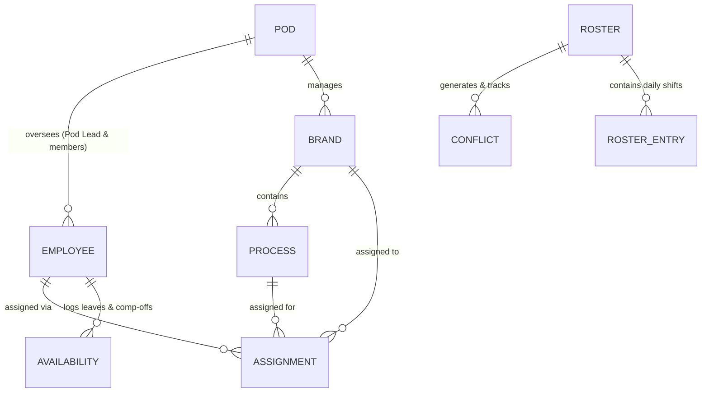
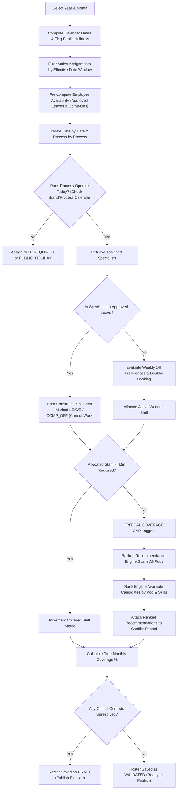

# DataStraw – Smart Roster Management System

> Production-grade workforce scheduling, constraint satisfaction, and operational conflict resolution platform designed for D2C customer operations teams managing multiple brands, pods, and specialized workflows.

[-success)](backend/tests/)
[](backend/)
[](frontend/)
[](backend/database.py)

---

## 1. Executive Summary & Problem Overview

D2C customer operations companies face complex scheduling dynamics:
- Over 30 operational specialists distributed across 12+ brands and 4 operational pods.
- **Asymmetrical staffing structures**: ~80% of client accounts are managed by a **single dedicated specialist** who owns all brand processes (Customer Support, Abandoned Cart, Non-Delivery Reports, Retention); the remaining ~20% have multi-resource teams with process specialization or shared shifts.
- **Divergent client operating calendars**: Some brands require **365-day 24/7 continuous operations**, others operate **daily excluding public holidays**, and others operate **Monday through Saturday with Sundays and public holidays off**. Different processes within the same brand may even follow different calendars.
- **Uncompromising SLA constraints**: A single unplanned leave or misaligned weekly off can leave an entire brand account unstaffed without warning.

**DataStraw RosterFlow** solves the underlying constraint-satisfaction scheduling problem with a deterministic, rule-based algorithm in Python, accompanied by a commercial-grade enterprise dashboard in React and MongoDB.

---

## 2. Technology Stack

| Layer | Technologies | Purpose |
|---|---|---|
| **Frontend** | React 18, Vite 5, React Router DOM v6, Bootstrap 5, Custom CSS, Axios, Lucide React, Recharts | Enterprise SaaS administration dashboard, interactive monthly calendar matrix, live conflict center, and telemetry charts. |
| **Backend** | Python 3.13, Flask 3.1, Flask-CORS, PyMongo 4.18, python-dotenv, gunicorn | Modular RESTful API architecture, deterministic constraint scheduling engine, backup recommendation scoring. |
| **Database** | MongoDB Atlas / PyMongo (with transparent persistent local JSON fallback for zero-dependency offline evaluation) | 11 collections with ObjectId references, indexing, and strict schema validation. |
| **Testing** | Python `unittest` | Automated test suite verifying 18 test cases across all 10 mandated scheduling rules and API workflows. |
| **Deployment** | Render Web Service (Backend), Render Static Site (Frontend), MongoDB Atlas | Production configuration with `render.yaml` infrastructure-as-code blueprint. |

---

## 3. System Architecture & Relational Data Modeling



### Database Collections (11 Collections in MongoDB)

1. `employees`: Specialist directory (`EMP-001` to `EMP-032`), designation, pod reference, skills list, preferred weekly offs, employment status.
2. `brands`: Client accounts (`BRD-001` to `BRD-012`), operating calendar mode (`365_DAYS`, `DAILY_EXCLUDING_HOLIDAYS`, `MON_SAT_EXCLUDING_HOLIDAYS`), public holiday policy, pod reference, minimum coverage requirements.
3. `processes`: Operational workflows (Customer Support CS, Abandoned Cart ACC, Non-Delivery Reports NDR, Retention RET), brand reference, calendar override rule, min/max staffing requirements.
4. `pods`: 4 Operational units (`POD-001` Alpha, `POD-002` Beta, `POD-003` Gamma, `POD-004` Delta), pod lead reference, member IDs, assigned brand IDs.
5. `assignments`: Decoupled `Employee <-> Brand <-> Process` mapping with effective start/end dates, allocation %, and primary status.
6. `availability`: Planned leaves, casual leaves, sick leaves, approved comp-offs, and pending requests with approval audit data.
7. `holidays`: Official 2026/2027 calendar holidays with geographic scope.
8. `rosters`: Monthly schedule documents (`ROSTER-2026-12`), overall coverage statistics, status (`DRAFT`, `VALIDATED`, `PUBLISHED`), and daily shift arrays.
9. `conflicts`: Rule violation center recording conflict ID, severity (`CRITICAL`, `HIGH`, `MEDIUM`, `LOW`), affected brand/process, explanation, suggested resolution, and resolution status.
10. `audit_logs`: Operational change history and manual overrides.
11. `users`: Role-Based Access Control (`ADMIN`, `OPERATIONS_MANAGER`, `POD_LEAD`) with salted cryptographic hashes.

---

## 4. Deterministic Scheduling Engine & Conflict Center

### Core Algorithm Workflow



### The 10 Enforced Scheduling Constraints

1. **RULE 1 (Hard Block)**: An employee on approved leave or comp-off CANNOT be assigned to work.
2. **RULE 2 (No Double Booking)**: An employee assigned to two separate brands cannot be scheduled simultaneously beyond 100% capacity.
3. **RULE 3 (Mandatory Process Coverage)**: Every process must meet its configured `min_employees` staffing threshold on every operating day.
4. **RULE 4 (365-Day Sunday Coverage)**: Brands operating 365 days mandate Sunday coverage.
5. **RULE 5 (Public Holiday Coverage)**: Brands with `WORK_ON_HOLIDAYS` policy mandate coverage on national public holidays.
6. **RULE 6 (Process Calendar Overrides)**: Processes under the same brand may adhere to distinct operating calendars (e.g. VoltTech CS runs 365 days while its NDR runs Mon-Sat).
7. **RULE 7 (Cross-Brand Conflict Check)**: Multi-brand specialists are checked for collisions across all assignments.
8. **RULE 8 (Fair Rest Days)**: Weekly offs are fairly rotated where multiple specialists share a process.
9. **RULE 9 (Constraint Priority)**: Mandatory client coverage takes strict precedence over soft preferred weekly-off requests.
10. **RULE 10 (Zero Silent Failures)**: Every coverage gap or conflict is logged with root cause explanation and actionable relief recommendations; rosters with unresolved critical gaps cannot be published.

### Backup Recommendation Scoring Heuristics

When a coverage gap occurs, the recommendation engine calculates candidate scores:
$$\text{Score} = 10 \text{ (Base Availability)} + 50 \times \mathbb{I}(\text{Same Pod}) + 25 \times \sum \mathbb{I}(\text{Matching Skills})$$
- Only active employees who are **NOT on leave** and **NOT already scheduled** on that date are considered.
- Candidates are ranked and surfaced in the Conflict Center with one-click reassignment.

---

## 5. Answers to Hiring Assessment Questions ("Tell Us How You Think")

### 1. How did you model employees, brands, processes, pods, and their relationships?
We avoided monolithic data structures and implemented a normalized, decoupled architecture using MongoDB ObjectId references:
- **Employees** belong to an **Operational Pod** overseen by a **Pod Lead**.
- **Brands** represent D2C client accounts with independent operating calendars and pod ownership.
- **Processes** represent operational streams (CS, ACC, NDR, Retention) nested under Brands, with the option to inherit or override the brand calendar and set independent staffing thresholds.
- **Assignments** form a dedicated associative collection (`employee_id`, `brand_id`, `process_id`, `effective_start_date`, `effective_end_date`, `allocation_percentage`). This enables seamless modeling of all 5 staffing cases without modifying database schemas.

### 2. How does your system generate a roster and determine whether it satisfies the required constraints?
Our scheduling engine in [backend/scheduler/engine.py](file:///c:/Problem%20statement/backend/scheduler/engine.py) operates deterministically:
1. Generates exact calendar dates for the target month and correlates national public holidays.
2. Resolves each process's operating status for each date based on its calendar mode (`365_DAYS`, `DAILY_EXCLUDING_HOLIDAYS`, or `MON_SAT_EXCLUDING_HOLIDAYS`).
3. Fetches approved leaves to enforce Rule 1 (hard unavailability block).
4. Allocates assigned specialists while checking cross-brand double booking and rotating weekly offs.
5. Evaluates if allocated count $\ge \text{min\_employees}$. If unsatisfied, a `COVERAGE_GAP` is stamped and an actionable conflict is generated.
6. The validation function returns a strict boolean `is_valid` (true only if critical gaps $= 0$), coverage percentage, and blocks publishing until resolved.

### 3. How did you handle the difference between single-resource brands and brands with multiple employees?
- **Single-Resource Brands (~80% of accounts)**: One dedicated specialist manages all brand processes. The engine groups these processes into a unified shift. If that specialist takes approved leave or a weekly off without relief, the engine flags a **CRITICAL** coverage gap across all processes, alerts the manager, and runs the backup recommender.
- **Multi-Employee Brands (~20% of accounts)**: Where different specialists own distinct processes (e.g. VoltTech: Priya on CS, Amit on ACC, Sneha on NDR), an absence by Amit triggers a gap **only** on ACC. CS and NDR remain actively covered. For shared processes (e.g. Zenith CS with Tarun and Ritu), one specialist can take a weekly off while the other maintains coverage, preserving client SLAs.

### 4. What happens when an employee managing all processes for a brand is unavailable on a required working day?
The system executes a structured response:
1. Identifies the unavailable employee and all linked brand processes.
2. Flags a **CRITICAL** conflict with a clear explanation (`Single dedicated employee Rahul Verma is unavailable on 2026-12-15 for EcoGlow Skincare`).
3. Sets daily shift status to `COVERAGE_GAP` (displayed with a pulsing alert indicator in the calendar matrix).
4. Deducts the gap from the total coverage percentage (never silently claims full coverage).
5. Invokes the recommendation engine to find available specialists in the same pod with matching skills.
6. Presents the manager with a one-click relief assignment workflow to restore coverage and revalidate.

### 5. How does your system handle conflicting requirements or insufficient staffing?
Hard constraints (approved leaves, client mandatory working days, process minimum staffing) are never silently bypassed. Incompatible conditions generate ranked entries in the **Conflict Center**:
- `CRITICAL`: 0 staff on a required client working day.
- `HIGH`: Double-booking across multiple brands or partial staffing shortfall.
- `MEDIUM`: Preferred weekly off overridden by mandatory client coverage.
The system permits saving the schedule as a `DRAFT` with persistent visual warnings, but strictly prevents state transition to `PUBLISHED` until critical conflicts are resolved.

### 6. Which parts of the process did you automate, and which did you leave under human control? Why?
- **Automated**:
  - Deterministic schedule generation based on calendar rules and effective dates.
  - Hard constraint enforcement (leave blocking, holiday policy checks).
  - Conflict detection and severity classification.
  - Relief candidate discovery, ranking, and scoring.
  - Automatic revalidation after any manual change or backup assignment.
- **Human Control**:
  - Leave approval/rejection decisions (managers must assess business context).
  - Relief resource assignment confirmation (managers review trade-offs).
  - Manual shift cell adjustments.
  - Final publication approval.
- **Why**: Operational scheduling involves human factors, employee fatigue, client nuances, and cost considerations that algorithms cannot fully observe. The system handles calculation and validation, while managers retain final authority.

### 7. If the company doubled its team and brand count?
1. **Database & Indexing**: Add compound indexes on `assignments(brand_id, process_id, status)` and `availability(employee_id, start_date, end_date)`.
2. **Horizontal Partitioning**: Partition roster generation jobs by Operational Pod; since pods are semi-autonomous operational units, scheduling can run concurrently across worker threads or Celery tasks.
3. **Roster Matrix Virtualization**: Implement virtualized row rendering (`react-window`) on the frontend calendar table to smoothly display 100+ rows across 31 date columns without DOM lag.
4. **Caching**: Cache brand operating calendar lookups and holiday tables in Redis during batch execution.

### 8. What would you improve with one additional week?
1. **Automated Swap Marketplace**: Allow specialists to initiate shift swaps with pod peers with automated conflict validation before manager approval.
2. **Fatigue & Fair-Share Guardrails**: Add constraints tracking consecutive working days (e.g. maximum 6 days without rest) and overtime compensation calculation.
3. **Webhook & Slack/Email Notifications**: Push instant notification alerts when a roster is published or when an approved leave creates an open gap.
4. **Export to Google Sheets via API**: Two-way synchronization of published rosters into Google Workspace.

---

## 6. API Reference

### Authentication & Users
- `POST /api/auth/login` – Authenticate user and receive signed JWT token.
- `POST /api/auth/register` – Register user with Role-Based Access Control.
- `GET /api/auth/me` – Retrieve current session profile.

### Employees
- `GET /api/employees` – List employees with search, pod filter, and status filter.
- `POST /api/employees` – Create specialist (enforces unique ID and email).
- `GET /api/employees/:id` – Detailed profile with active brand assignments and leave history.
- `PUT /api/employees/:id` – Update employee profile.
- `DELETE /api/employees/:id` – Delete specialist (safeguarded against active assignments).

### Brands & Processes
- `GET /api/brands` – List client brands with operating calendar and pod metadata.
- `POST /api/brands` – Register brand (`365_DAYS`, `DAILY_EXCLUDING_HOLIDAYS`, `MON_SAT_EXCLUDING_HOLIDAYS`).
- `PUT /api/brands/:id` – Update brand details and holiday policy.
- `DELETE /api/brands/:id` – Delete brand.
- `GET /api/processes` – List operational processes (filter by `brand_id`).
- `POST /api/processes` – Create process under a brand with custom calendar and min/max staffing.
- `PUT /api/processes/:id` – Update process.
- `DELETE /api/processes/:id` – Delete process.

### Operational Pods
- `GET /api/pods` – List pods with pod leads, member counts, and brand allocations.
- `POST /api/pods` – Create operational pod.
- `GET /api/pods/:id` – Detailed pod overview with members list.
- `PUT /api/pods/:id` – Update pod.

### Assignments
- `GET /api/assignments` – Query resource assignments.
- `POST /api/assignments` – Create mapping (validates employee, brand, and that process belongs to brand).
- `PUT /api/assignments/:id` – Update assignment window or allocation.
- `DELETE /api/assignments/:id` – Remove assignment.
- `GET /api/assignments/backup-recommendations` – Ranked backup suggestions for a date and process.

### Availability & Leaves
- `GET /api/availability` – Query leaves and comp-offs.
- `POST /api/availability` – Log leave request (validates against overlapping records).
- `POST /api/availability/:id/approve` – Approve leave (activates roster impact).
- `POST /api/availability/:id/reject` – Reject leave request.
- `DELETE /api/availability/:id` – Delete leave record.

### Public Holidays
- `GET /api/holidays` – Query public holidays.
- `POST /api/holidays` – Add official holiday.
- `PUT /api/holidays/:id` – Update holiday date or scope.
- `DELETE /api/holidays/:id` – Remove holiday.

### Monthly Roster & Engine
- `POST /api/rosters/generate` – Deterministically generate monthly roster (`year`, `month`).
- `GET /api/rosters` – List generated rosters.
- `GET /api/rosters/:id` – Fetch roster matrix (supports `company`, `pod`, `brand`, `process`, `employee` views).
- `PUT /api/rosters/:id/entry` – Modify individual schedule cell (triggers auto-revalidation).
- `POST /api/rosters/:id/reassign-backup` – Replace unstaffed gap with relief resource and update conflicts.
- `POST /api/rosters/:id/validate` – Run full constraint validation check.
- `POST /api/rosters/:id/publish` – Publish roster (blocks if unresolved critical gaps exist).

### Conflict Center
- `GET /api/conflicts` – List conflicts filtered by severity, status, brand, or date.
- `GET /api/conflicts/:id/backups` – Return ranked candidate recommendations for a conflict.
- `PUT /api/conflicts/:id/resolve` – Manually resolve conflict with verification notes.

### Dashboard & Reports
- `GET /api/dashboard/stats` – Real-time KPI telemetry, pod distribution, and activity feed.
- `GET /api/reports/summary` – Brand SLA coverage compliance summary.
- `GET /api/reports/export-csv` – Stream live database data as CSV (`type=company`, `type=conflicts`, `type=leaves`).

---

## 7. Installation & Local Setup

### Prerequisites
- Python 3.10+
- Node.js 18+ and npm
- (Optional) MongoDB local or MongoDB Atlas URI (if omitted, high-fidelity persistent fallback runs automatically)

### 1. Clone & Set Up Backend

```bash
cd backend

# Create and activate virtual environment
python -m venv venv
# On Windows:
venv\Scripts\activate
# On Linux/macOS:
source venv/bin/activate

# Install dependencies
pip install -r requirements.txt

# Seed benchmark database (32 employees, 12 brands, 4 pods, 35 processes, holidays, leaves)
python seeds/seed_data.py

# Start Flask backend server
python app.py
```
Backend will start on `http://localhost:5000`.

### 2. Set Up Frontend

```bash
cd frontend

# Install dependencies
npm install

# Start Vite development server
npm run dev
```
Frontend will be available at `http://localhost:3000`.

---

## 8. Automated Test Execution

Run the complete test suite verifying all 10 mandated scheduling rules and API workflows:

```bash
cd backend

# Run scheduler constraint tests (10/10 scenarios)
python tests/test_scheduler.py

# Run API endpoint tests (8/8 scenarios)
python tests/test_api.py
```

### Mandated Test Scenarios Covered
- **TEST 1**: Single-employee brand operating 365 days shows a coverage gap when specialist is unavailable.
- **TEST 2**: Three-employee brand with separate processes isolates gap to only the affected process when one specialist takes leave.
- **TEST 3**: Brand not operating on Sundays requires no Sunday staffing.
- **TEST 4**: Brand operating on public holidays requires mandatory coverage on those holidays.
- **TEST 5**: Employee assigned to multiple brands is prevented from double-booking.
- **TEST 6**: Approved leaves strictly prevent employee shift allocation.
- **TEST 7**: Pending leaves do not prematurely block roster generation.
- **TEST 8**: System identifies insufficient staffing for multi-resource processes (e.g. Zenith CS min 2).
- **TEST 9**: Manual schedule modifications trigger automatic revalidation.
- **TEST 10**: Rosters with unresolved critical coverage gaps cannot be published.

---

## 9. Demo Accounts & Evaluation Credentials

Use the one-click demo switcher on the Login page or in Settings:

| Role | Email | Password | Permissions |
|---|---|---|---|
| **Admin** | `admin@datastraw.com` | `admin123` | Full administrative control across all pods, brands, and settings. |
| **Operations Manager** | `manager@datastraw.com` | `manager123` | Roster generation, validation, leave approvals, backup assignment, publication. |
| **Alpha Pod Lead** | `podlead@datastraw.com` | `lead123` | Pod-level team oversight (Priya Sharma, Alpha Pod). |

---

## 10. Deployment Instructions

### Option A: Render Infrastructure Blueprint (`render.yaml`)
1. Connect the GitHub repository to [Render.com](https://render.com).
2. Render detects `render.yaml` and deploys:
   - `datastraw-roster-backend`: Python Web Service running Gunicorn.
   - `datastraw-roster-frontend`: Static Site running Vite build.
3. Configure `MONGO_URI` in the backend service environment variables with your MongoDB Atlas connection string.

### Option B: Manual Production Deployment
- **Backend**:
  - Runtime: Python 3
  - Build Command: `pip install -r requirements.txt`
  - Start Command: `gunicorn app:app --bind 0.0.0.0:$PORT`
- **Frontend**:
  - Build Command: `npm install && npm run build`
  - Publish Directory: `dist`
  - Environment Variable: `VITE_API_BASE_URL=https://<your-backend-domain>/api`

---

## 11. 3–5 Minute Demo Video Walkthrough Plan

1. **Minute 0:00 – 0:45: System Overview & Telemetry Dashboard**
   - Introduce DataStraw RosterFlow: 32 specialists, 12 brands, 4 operational pods.
   - Walk through live KPI cards, pod distribution bar chart, shift breakdown pie chart, and upcoming holidays.
2. **Minute 0:45 – 1:30: Brand Operating Rules & Asymmetrical Staffing**
   - Demonstrate single-resource brands (EcoGlow, 365 days) vs multi-resource brands (VoltTech with CS, ACC, NDR process owners).
   - Show how processes can override brand operating calendars.
3. **Minute 1:30 – 2:30: Monthly Roster Generation & 5 Perspective Views**
   - Navigate to Roster Management for December 2026.
   - Trigger deterministic generation: show company-wide matrix, pod-wise view, brand-wise view, and employee view.
   - Explain status badge codes (`W`, `WO`, `LV`, `CO`, `PH`, `GAP!`).
4. **Minute 2:30 – 3:45: Interactive Change Management & Backup Reassignment**
   - Open Change Management simulator.
   - Show Rahul Verma taking approved leave on Dec 15.
   - Show instant detection of CRITICAL coverage gap on EcoGlow.
   - Run the Backup Recommendation Engine to view ranked, available specialists with suitability scores.
   - Assign the relief specialist and watch the roster revalidate and coverage restore to 100%.
5. **Minute 3:45 – 4:30: Conflict Center & Data Exports**
   - Review the Conflict Center severity filters.
   - Demonstrate CSV export of the live company schedule and conflict audit log.
   - Conclude with publication validation guardrails.

---

## 12. Approach Note (2–3 Sentences)

> We solved DataStraw's workforce scheduling challenge by modeling operational relationships as decoupled, first-class entities in MongoDB and developing a deterministic, rule-based constraint satisfaction engine in Python. The system differentiates between single-resource and multi-employee brand structures, rigorously enforces client operating calendars, and automatically detects unstaffed gaps with intelligent backup recommendation heuristics. A modern React enterprise dashboard provides comprehensive management views, interactive cell adjustments, and publication safeguards that preserve client SLAs.

---

## 13. Submission Format

- **To**: `ozair.shaikh@datastraw.in`, `aryan.jaiswal@datastraw.in`
- **CC**: `talent@datastraw.in`
- **Subject**: `Smart Roster Management System Assignment - [Your Full Name]`

### Email Body Template:
```text
Dear DataStraw Hiring Team,

Please find my submission for the DataStraw Tech Internship Assessment: Smart Roster Management System.

1. Application URL: [Live Deployed URL]
2. GitHub Repository: [GitHub Repository Link]
3. LinkedIn Profile: [Your LinkedIn Profile Link]
4. Approach Note:
We solved DataStraw's workforce scheduling challenge by modeling operational relationships as decoupled, first-class entities in MongoDB and developing a deterministic, rule-based constraint satisfaction engine in Python. The system differentiates between single-resource and multi-employee brand structures, rigorously enforces client operating calendars, and automatically detects unstaffed gaps with intelligent backup recommendation heuristics. A modern React enterprise dashboard provides comprehensive management views, interactive cell adjustments, and publication safeguards that preserve client SLAs.

The repository includes a comprehensive README with database schemas, algorithm explanations, answers to all 8 assessment questions, a 3–5 minute video plan, and 18 passing automated test cases.

Looking forward to your feedback.

Best regards,
[Your Full Name]
```
