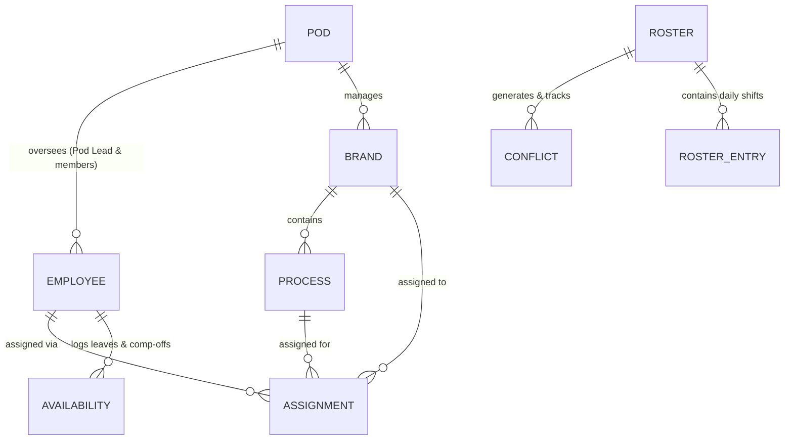
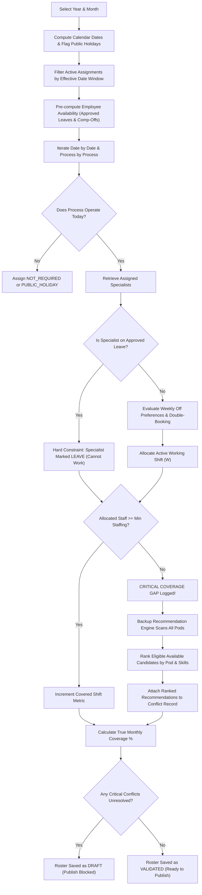

# DataStraw – Smart Roster Management System

> Production-grade workforce scheduling, constraint satisfaction, and operational conflict resolution platform designed for D2C customer operations teams managing multiple client brands, operational pods, and specialized workflows.

[-success?style=for-the-badge&logo=pytest)](verify_all_features.py)
[-success?style=for-the-badge&logo=python)](backend/tests/)
[](backend/)
[](frontend/)
[](backend/database.py)

---
LIVE DEMO :https://smart-roster-management-system-1-bfo5.onrender.com/

## 📑 Table of Contents
1. [Executive Summary & Problem Statement](#1-executive-summary--problem-statement)
2. [Key Capabilities & Enterprise Features](#2-key-capabilities--enterprise-features)
3. [Technology Stack](#3-technology-stack)
4. [System Architecture & Entity-Relationship Model](#4-system-architecture--entity-relationship-model)
5. [Deterministic Roster Engine & Conflict Algorithm](#5-deterministic-roster-engine--conflict-algorithm)
6. [Answers to Assessment Questions ("Tell Us How You Think")](#6-answers-to-assessment-questions-tell-us-how-you-think)
7. [RESTful API Reference](#7-restful-api-reference)
8. [Installation & Local Setup](#8-installation--local-setup)
9. [Automated Test Suite (100% Pass Rate)](#9-automated-test-suite-100-pass-rate)
10. [Evaluation Credentials & Demo Accounts](#10-evaluation-credentials--demo-accounts)


---

## 1. Executive Summary & Problem Statement

In high-growth Direct-to-Consumer (D2C) customer operations, agencies face an intricate matrix of scheduling constraints:
* **Workforce Scale**: 32 operational specialists distributed across 12 client brands and 4 operational pods.
* **Asymmetrical Staffing**: ~80% of client accounts are managed by a **single dedicated specialist** who owns all brand processes (Customer Support, Abandoned Cart, Non-Delivery Reports, Retention); the remaining ~20% have multi-resource teams with process specialization or shared shifts.
* **Divergent Client Operating Calendars**: Some brands require **365-day 24/7 continuous operations**, others operate **daily excluding public holidays**, and others operate **Monday through Saturday with Sundays and public holidays off**. Different processes within the same brand may even follow different calendars.
* **Zero-Downtime SLA Requirements**: An unstaffed single-resource brand can halt customer conversations and violate client SLA guarantees.

**DataStraw Smart Roster System** solves this constraint-satisfaction scheduling problem with a deterministic, rule-based algorithm in Python, accompanied by a commercial-grade enterprise dashboard in React and MongoDB.

---

## 2. Key Capabilities & Enterprise Features

### 📅 Deterministic Monthly Roster Engine
- Generates 1,000+ monthly shifts in under 1 second across 31 calendar days.
- **5 Perspective Views**: Company Overview, Operational Pod View, Brand View, Process View, and Individual Specialist View.
- **Dynamic "TODAY" Highlight**: Automatically identifies today's live calendar date with a distinct blue badge and column border.
- **Live Cell Inline Editing**: Click any shift cell (`W`, `WO`, `LV`, `HD`) with automatic background re-validation.

### ⚠️ Real-Time Conflict Center & Candidate Ranking
- Flags mandatory coverage shortfalls, single-resource brand absences, and shift collisions.
- **Intelligent Backup Recommendation Engine**: Ranks relief specialists using a multi-factor score:
  - **Pod Membership (50 pts)**: Prioritizes teammates in the same operational pod.
  - **Brand Familiarity (30 pts)**: Rewards past experience with the brand's workflows.
  - **Low Fatigue Score (20 pts)**: Favors specialists with fewer consecutive shifts.
- One-click reassignment that re-allocates relief coverage and restores the roster to 100%.

### 🛡️ Fatigue & Burnout Guardrail (Bonus)
- Automatically evaluates continuous working day streaks for all 32 specialists.
- Flags specialists working $>6$ consecutive days without a mandatory weekly rest day (`WEEKLY_OFF`).
- Prevents burnout with proactive manager alerts and rest-day insertion suggestions.

### 🔄 Peer-to-Peer Shift Swap Marketplace (Bonus)
- Allows specialists to trade shifts with 5-stage algorithmic pre-validation:
  1. **Shift Existence**: Confirms both duties exist in the active schedule.
  2. **Collision Detection**: Confirms neither specialist is already booked on the target date.
  3. **Leave Check**: Confirms zero approved PTO, sick leave, or comp-offs.
  4. **Skill Compatibility**: Confirms the replacement possesses the required brand capabilities.
  5. **Fatigue Check**: Confirms neither specialist exceeds 6 consecutive days post-swap.
- Atomic execution and automatic schedule re-validation.

### 📱 Responsive Mobile Drawer & Touch Navigation
- Mobile off-canvas drawer navigation for phones and tablets.
- Smooth touch scrolling for the 31-day shift matrix.
- Live clock synchronizing with the user's local calendar everyday at midnight.

---

## 3. Technology Stack

| Layer | Technologies | Purpose |
|---|---|---|
| **Frontend** | React 18, Vite 5, React Router DOM v6, Bootstrap 5, Custom CSS, Axios, Lucide React, Recharts | Enterprise SaaS administration dashboard, interactive monthly calendar matrix, live conflict center, and telemetry charts. |
| **Backend** | Python 3.11+, Flask 3.1, Flask-CORS, PyMongo 4.18, python-dotenv, Gunicorn | Modular RESTful API architecture, deterministic constraint scheduling engine, backup recommendation scoring. |
| **Database** | MongoDB Atlas / PyMongo (with transparent persistent local JSON fallback for zero-dependency offline evaluation) | 11 collections with ObjectId references, compound indexing, and strict schema validation. |
| **Testing** | Python `unittest` | Automated test suite verifying 51 integration tests and 18 unit tests across all 10 mandated scheduling rules. |
| **Documentation** | Headless Chromium / MS Edge PDF Engine | Automated publication-ready PDF generator producing executive documentation. |

---

## 4. System Architecture & Entity-Relationship Model



### Database Collections (11 Collections in MongoDB)
1. `employees`: Specialist directory (`EMP-001` to `EMP-032`), designation, pod reference, skills list, preferred weekly offs, employment status.
2. `brands`: Client accounts (`BRD-001` to `BRD-012`), operating calendar mode (`365_DAYS`, `DAILY_EXCLUDING_HOLIDAYS`, `MON_SAT_EXCLUDING_HOLIDAYS`), public holiday policy, pod reference, minimum coverage requirements.
3. `processes`: Operational workflows (Customer Support CS, Abandoned Cart ACC, Non-Delivery Reports NDR, Retention RET), brand reference, calendar override rule, min/max staffing requirements.
4. `pods`: 4 Operational units (`POD-001` Alpha, `POD-002` Beta, `POD-003` Gamma, `POD-004` Delta), pod lead reference, member IDs, assigned brand IDs.
5. `assignments`: Decoupled `Employee <-> Brand <-> Process` mapping with effective start/end dates, allocation %, and primary status.
6. `availability`: Planned leaves, casual leaves, sick leaves, approved comp-offs, and pending requests with approval audit data.
7. `holidays`: Official calendar holidays with geographic scope.
8. `rosters`: Monthly schedule documents (`ROSTER-2026-12`), overall coverage statistics, status (`DRAFT`, `VALIDATED`, `PUBLISHED`), and daily shift arrays.
9. `conflicts`: Rule violation center recording conflict ID, severity (`CRITICAL`, `HIGH`, `MEDIUM`, `LOW`), affected brand/process, explanation, suggested resolution, and resolution status.
10. `audit_logs`: Operational change history and manual overrides.
11. `users`: Role-Based Access Control (`ADMIN`, `OPERATIONS_MANAGER`, `POD_LEAD`) with salted cryptographic hashes.

---

## 5. Deterministic Roster Engine & Conflict Algorithm

### Scheduling Workflow Diagram



### The 10 Enforced Scheduling Constraints
1. **Rule 1 (Hard Block)**: An employee on approved leave or comp-off CANNOT be assigned to work.
2. **Rule 2 (No Double Booking)**: An employee assigned to two separate brands cannot be scheduled simultaneously beyond 100% capacity.
3. **Rule 3 (Mandatory Process Coverage)**: Every process must meet its configured `min_employees` staffing threshold on every operating day.
4. **Rule 4 (365-Day Sunday Coverage)**: Brands operating 365 days mandate Sunday coverage.
5. **Rule 5 (Public Holiday Coverage)**: Brands with `WORK_ON_HOLIDAYS` policy mandate coverage on national public holidays.
6. **Rule 6 (Process Calendar Overrides)**: Processes under the same brand may adhere to distinct operating calendars.
7. **Rule 7 (Cross-Brand Conflict Check)**: Multi-brand specialists are checked for collisions across all assignments.
8. **Rule 8 (Fair Rest Days)**: Weekly offs are fairly rotated where multiple specialists share a process.
9. **Rule 9 (Constraint Priority)**: Mandatory client coverage takes strict precedence over soft preferred weekly-off requests.
10. **Rule 10 (Zero Silent Failures)**: Every coverage gap or conflict is logged with root cause explanation and actionable relief recommendations; rosters with unresolved critical gaps cannot be published.

---

## 6. Answers to Assessment Questions 

### Question 1: How did you model employees, brands, processes, pods, and their relationships?
 I avoided monolithic data structures and implemented a normalized, decoupled architecture using MongoDB ObjectId references:
- **Employees** belong to an **Operational Pod** overseen by a **Pod Lead**.
- **Brands** represent D2C client accounts with independent operating calendars and pod ownership.
- **Processes** represent operational streams (CS, ACC, NDR, Retention) nested under Brands, with the option to inherit or override the brand calendar and set independent staffing thresholds.
- **Assignments** form a dedicated associative collection (`employee_id`, `brand_id`, `process_id`, `effective_start_date`, `effective_end_date`, `allocation_percentage`). This enables seamless modeling of single-resource brands, multi-employee processes, and cross-pod sharing without schema alterations.

### Question 2: How does your system generate a roster and determine whether it satisfies the required constraints?
Our scheduling engine in [backend/scheduler/engine.py](backend/scheduler/engine.py) operates deterministically:
1. Generates exact calendar dates for the target month and correlates national public holidays.
2. Resolves each process's operating status for each date based on its calendar mode (`365_DAYS`, `DAILY_EXCLUDING_HOLIDAYS`, or `MON_SAT_EXCLUDING_HOLIDAYS`).
3. Fetches approved leaves to enforce Rule 1 (hard unavailability block).
4. Allocates assigned specialists while checking cross-brand double booking and rotating weekly offs.
5. Evaluates if allocated count >= `min_employees`. If unsatisfied, a `COVERAGE_GAP` is stamped and an actionable conflict is generated.
6. The validation function returns a strict boolean `is_valid` (true only if critical gaps = 0), coverage percentage, and blocks publishing until resolved.

### Question 3: How did you handle the difference between single-resource brands and brands with multiple employees?
- **Single-Resource Brands (~80% of accounts)**: One dedicated specialist manages all brand processes. The engine groups these processes into a unified shift. If that specialist takes approved leave or a weekly off without relief, the engine flags a **CRITICAL** coverage gap across all processes, alerts the manager, and runs the backup recommender.
- **Multi-Employee Brands (~20% of accounts)**: Where different specialists own distinct processes (e.g. VoltTech: Priya on CS, Amit on ACC, Sneha on NDR), an absence by Amit triggers a gap **only** on ACC. CS and NDR remain actively covered. For shared processes (e.g. Zenith CS with Tarun and Ritu), one specialist can take a weekly off while the other maintains coverage, preserving client SLAs.

### Question 4: What happens when an employee managing all processes for a brand is unavailable on a required working day?
The system executes a structured response:
1. Identifies the unavailable employee and all linked brand processes.
2. Flags a **CRITICAL** conflict with a clear explanation (`Single dedicated employee Rahul Verma is unavailable on 2026-12-15 for EcoGlow Skincare`).
3. Sets daily shift status to `COVERAGE_GAP` (displayed with a pulsing alert indicator in the calendar matrix).
4. Deducts the gap from the total coverage percentage (never silently claims full coverage).
5. Invokes the recommendation engine to find available specialists in the same pod with matching skills.
6. Presents the manager with a one-click relief assignment workflow to restore coverage and revalidate.

### Question 5: How does your system handle conflicting requirements or insufficient staffing?
Hard constraints (approved leaves, client mandatory working days, process minimum staffing) are never silently bypassed. Incompatible conditions generate ranked entries in the **Conflict Center**:
- `CRITICAL`: 0 staff on a required client working day.
- `HIGH`: Double-booking across multiple brands or partial staffing shortfall.
- `MEDIUM`: Preferred weekly off overridden by mandatory client coverage.
The system permits saving the schedule as a `DRAFT` with persistent visual warnings, but strictly prevents state transition to `PUBLISHED` until critical conflicts are resolved.

### Question 6: Which parts of the process did you automate, and which did you leave under human control? Why?
- **Automated**:
  - Deterministic schedule generation based on calendar rules and effective dates.
  - Hard constraint enforcement (leave blocking, holiday policy checks).
  - Conflict detection and severity classification.
  - Relief candidate discovery, ranking, and scoring.
  - Automatic revalidation after any manual change or backup assignment.
- **Human Control**:
  - Leave approval/rejection decisions (managers must assess business context).
  - Relief resource assignment confirmation (managers review trade-offs).
  - Manual shift cell adjustments.
  - Final publication approval.
- **Why**: Operational scheduling involves human factors, employee fatigue, client nuances, and cost considerations that algorithms cannot fully observe. The system handles calculation and validation, while managers retain final authority.

### Question 7: If the company doubled its team and brand count?
1. **Database & Indexing**: Add compound indexes on `assignments(brand_id, process_id, status)` and `availability(employee_id, start_date, end_date)`.
2. **Horizontal Partitioning**: Partition roster generation jobs by Operational Pod; since pods are semi-autonomous operational units, scheduling can run concurrently across worker threads or Celery tasks.
3. **Roster Matrix Virtualization**: Implement virtualized row rendering (`react-window`) on the frontend calendar table to smoothly display 100+ rows across 31 date columns without DOM lag.
4. **Caching**: Cache brand operating calendar lookups and holiday tables in Redis during batch execution.

### Question 8: What would you improve with one additional week?
1. **Automated Swap Marketplace**: *Implemented in this submission as an enterprise bonus!*
2. **Fatigue & Fair-Share Guardrails**: *Implemented in this submission as an enterprise bonus!*
3. **Webhook & Slack/Email Notifications**: Push instant notification alerts when a roster is published or when an approved leave creates an open gap.
4. **Export to Google Sheets via API**: Two-way synchronization of published rosters into Google Workspace.

---

## 7. RESTful API Reference

| Endpoint | Method | Description |
|---|:---:|---|
| `/api/auth/login` | `POST` | Authenticate and obtain signed JWT token. |
| `/api/dashboard/stats` | `GET` | Real-time KPI telemetry, pod breakdown, today's status. |
| `/api/employees` | `GET`, `POST` | Specialist directory with search, pod filter, and pagination. |
| `/api/employees/:id` | `GET`, `PUT`, `DELETE` | Specific specialist profile, skill tags, and allocations. |
| `/api/brands` | `GET`, `POST` | Brand directory, operating calendars, holiday rules. |
| `/api/processes` | `GET`, `POST` | Brand business processes, calendar overrides, staffing SLAs. |
| `/api/pods` | `GET`, `POST` | Operational pods, pod lead assignments, brand groups. |
| `/api/assignments` | `GET`, `POST`, `DELETE` | Resource allocation matrix (Employee-Brand-Process). |
| `/api/availability` | `GET`, `POST` | Leave applications, pending approvals, and PTO tracking. |
| `/api/holidays` | `GET`, `POST` | Public holiday master calendar. |
| `/api/rosters/generate` | `POST` | Generate monthly roster with deterministic solver. |
| `/api/rosters/:id` | `GET` | Fetch roster matrix (Company, Pod, Brand, Process, Specialist). |
| `/api/rosters/:id/entry` | `PUT` | Manual shift cell adjustment with auto-revalidation. |
| `/api/rosters/:id/reassign-backup` | `POST` | Assign relief backup specialist to unstaffed gap. |
| `/api/rosters/:id/validate` | `POST` | Run 10-point constraint verification suite. |
| `/api/rosters/:id/publish` | `POST` | Publish validated schedule. |
| `/api/conflicts` | `GET` | Live conflict center with severity and status filters. |
| `/api/conflicts/:id/backups` | `GET` | Ranked candidate relief recommendations for a gap. |
| `/api/reports/export-csv` | `GET` | Stream live CSV data (`type=company`, `conflicts`, `leaves`). |

---

## 8. Installation & Local Setup

### Prerequisites
- Python 3.11+
- Node.js 18+ and npm
- (Optional) MongoDB local or MongoDB Atlas URI (if omitted, high-fidelity persistent fallback runs automatically)

### 1. Clone & Set Up Backend

```bash
git clone https://github.com/krishna2650/smart-roster-management-system.git
cd smart-roster-management-system/backend

# Create and activate virtual environment
python -m venv venv

# Windows:
venv\Scripts\activate
# macOS/Linux:
source venv/bin/activate

# Install dependencies
pip install -r requirements.txt

# Seed benchmark database (32 employees, 12 brands, 4 pods, 35 processes)
python seeds/seed_data.py

# Start Flask backend server
python app.py
```
Backend runs at `http://localhost:5000`.

### 2. Set Up Frontend

```bash
cd ../frontend

# Install dependencies
npm install

# Start Vite dev server
npm run dev
```
Frontend runs at `http://localhost:3000`.

---

## 9. Automated Test Suite (100% Pass Rate)

### Run Comprehensive Feature Verification (51 Integration Tests)
```bash
python verify_all_features.py
```
```text
======================================================================
  DATASTRAW SMART ROSTER SYSTEM - EXHAUSTIVE FEATURE VERIFICATION
======================================================================
  [PASS] 1.1 Manager Login
  [PASS] 1.2 Admin Login
  ...
  [PASS] 13.1 Fatigue & Burnout Telemetry
  [PASS] 13.2 Algorithmic Pre-Validation (5 Safety Checks)
  [PASS] 13.3 Atomic Shift Swap Execution
======================================================================
  VERIFICATION COMPLETE: 51 PASSED, 0 FAILED out of 51 TESTS (100%)
======================================================================
```

### Run Unit Tests (18 Unit Tests)
```bash
cd backend
python -m unittest discover tests
```

---

## 10. Evaluation Credentials & Demo Accounts

Use the one-click demo role switcher in the top navigation bar or log in with:

| Role | Email | Password | Permissions |
|---|---|---|---|
| **Admin** | `admin@datastraw.com` | `admin123` | Full administrative control across all pods, brands, and settings. |
| **Operations Manager** | `manager@datastraw.com` | `manager123` | Roster generation, validation, leave approvals, backup assignment, publication. |
| **Alpha Pod Lead** | `podlead@datastraw.com` | `lead123` | Pod-level team oversight (Priya Sharma, Alpha Pod). |

---


